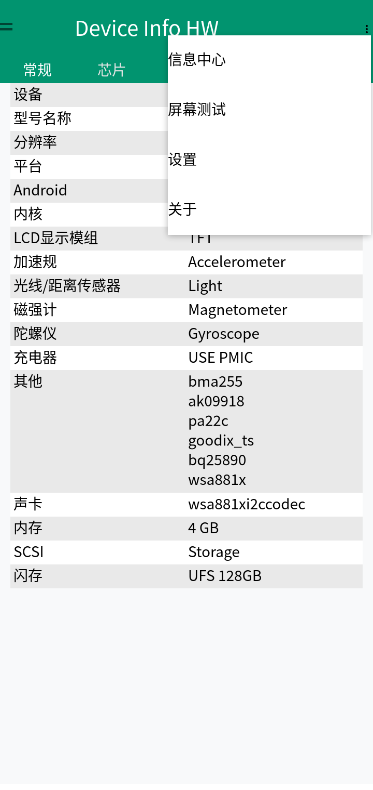
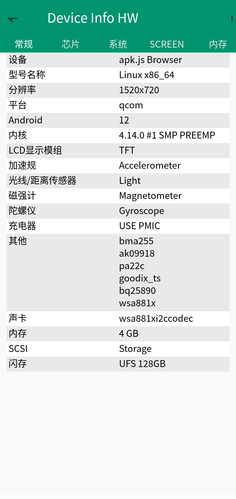

# apk.js

**English** | [简体中文](./README.zh-CN.md)

[Docs](https://caofangkuai.github.io/apk.js/) · [Playground](https://caofangkuai.github.io/apk.js/playground.html)

[](https://github.com/caofangkuai/apk.js/actions/workflows/deploy.yml)
[](https://github.com/caofangkuai/apk.js/stargazers)
[](https://github.com/caofangkuai/apk.js/network/members)
[](https://github.com/caofangkuai/apk.js)
[](https://github.com/caofangkuai/apk.js/blob/main/LICENSE)

Run Android APKs in the browser with plain JavaScript. apk.js parses `classes.dex`, `AndroidManifest.xml` and `resources.arsc` straight from the APK, executes the application logic with a DEX bytecode interpreter, and paints the UI through a Canvas-based subset of the Android Framework. No device, no emulator, no native libraries.

> **一切开始，尽在 apk.js** — Everything starts with apk.js.

<p align="center">
  
  
</p>

<p align="center"><em>DeviceInfoHW running in apk.js — overflow menu and navigation drawer.</em></p>

## Features

- **Pure frontend.** Unpacking, parsing, execution and rendering all happen inside the browser. There is no backend.
- **DEX interpreter.** Covers the bulk of the Dalvik instruction set, with exception handling, `switch`, arrays, fields and method dispatch.
- **Resource parsing.** Binary `AndroidManifest.xml` (AXML) and the `resources.arsc` resource table.
- **Framework subset.** `Activity` lifecycle, `View` tree with measure and layout, `LinearLayout` / `FrameLayout` / `RelativeLayout` / `ScrollView`, `TextView` / `Button` / `EditText` / `ImageView` / `ProgressBar`, `ActionBar` / `Toolbar`, `Toast`, `Context` / `Intent` / `Bundle`, and more.
- **Drawables and themes.** `shape` / `vector` / `ripple` / `selector` rendering, `RippleDrawable` content unwrapping, `GradientDrawable`, `backgroundTint`, `@android:color/*` resolution, and `Context.setTheme` inheritance.
- **Soft keyboard input.** Tapping an `EditText` focuses it and raises the system keyboard through a hidden-input bridge. Supports `InputMethodManager`, a blinking caret, and `getSelectionStart` / `setSelection`.
- **System and reflection.** `android.os.Build` / `VERSION`, `Class.forName` / `getMethod` / `Method.invoke` (including primitive argument unboxing), and multi-`Activity` navigation through `startActivity` with `Intent` extras.
- **Runnable sample.** The repository ships `samples/hello-dex.apk`. Open the page and it runs: counters, input echo, dynamic view insertion, progress bars, shape-backed buttons, `Build` info, reflection calls, and a jump to a second `Activity`.

## Quick start

```bash
# Install dependencies
npm install

# Bundle into dist/
npm run build

# Serve the static site
npm run serve
```

Open <http://localhost:8080>, then click **Choose APK** or drop an APK onto the page.

The build output `dist/apk.min.js` and `dist/android-framework.min.js` is committed, so you can also copy `index.html`, `dist/`, `vendor/` and `samples/` onto any static host and skip the build step.

## Build output

`npm run build` runs webpack and produces two ES modules:

| Artifact | Contents |
| --- | --- |
| `dist/android-framework.min.js` | Framework only: DEX parsing, runtime, resource parsing, Canvas Android Framework subset. No DOM or page logic. |
| `dist/apk.min.js` | Caller layer: device info, render target, file loading, status and log callbacks. Depends on the file above. |

`index.html` loads `dist/apk.min.js` through `<script type="module">`, which pulls in `android-framework.min.js`. JSZip is provided as a global from `vendor/jszip.min.js`.

## Using it on a page

`apk.min.js` exports `createSimulator` and `ApkSimulator`. The caller supplies the device info and the render target:

```html
<script src="vendor/jszip.min.js"></script>
<script type="module">
  import { createSimulator } from './dist/apk.min.js';

  const sim = createSimulator({
    // Render target: a CSS selector, a DOM element, or an existing canvas
    element: '#phone-screen',
    // Device info
    device: {
      width: 360,
      height: 640,
      dpr: window.devicePixelRatio || 1,
      style: 'material',
      maxApkSize: 50 * 1024 * 1024,
    },
    onLog: (entry) => console.log(`[${entry.level}] ${entry.tag}: ${entry.message}`),
    onFinished: () => console.log('Activity finished'),
    onError: (error) => console.error(error),
  });

  // Load from a File object (for example from <input type="file">)
  await sim.loadFromFile(file);

  // URL, ArrayBuffer and an unpacked JSZip instance also work
  // await sim.loadFromUrl('samples/hello-dex.apk');
  // await sim.loadFromArrayBuffer(buffer);
  // await sim.loadFromZip(zip);

  sim.setDevice({ width: 280, height: 480 }); // Resize while running
  sim.destroy();                              // Stop and remove the canvas
</script>
```

| Option | Description |
| --- | --- |
| `element` | Render target. Accepts a CSS selector string or a DOM element; a canvas is created inside it. |
| `canvas` | Use an existing `<canvas>`. Takes precedence over `element`. |
| `device.width` / `device.height` | Logical resolution. Defaults to 360×640. |
| `device.dpr` | Device pixel ratio. Defaults to `window.devicePixelRatio` capped at 2. The canvas backing size is logical size × dpr. |
| `device.style` | Theme style. Defaults to `material`. |
| `device.maxApkSize` | APK size limit. Defaults to 50MB. |
| `onLog` / `onFinished` / `onError` | Log, finish and error callbacks. |

| Method | Description |
| --- | --- |
| `loadFromFile(file)` | Load from a browser `File`. |
| `loadFromUrl(url, options)` | Download with `fetch`, then load. |
| `loadFromArrayBuffer(buffer)` | Load from binary contents. |
| `loadFromZip(zip)` | Load from a JSZip instance. |
| `setDevice(device)` | Update device info and apply the new size immediately. |
| `stop()` / `destroy()` | Stop running / stop and clean up the canvas. |
| `vm` | The current `JavaVM` instance (read-only). |

During development, `npm run build:dev` produces an unminified bundle with source maps.

## Project layout

```
.
├── apk.js                    # Public entry source (webpack entry)
├── index.html                # Demo page
├── webpack.config.js         # Build configuration
├── dist/                     # Build output (committed)
│   ├── apk.min.js
│   └── android-framework.min.js
├── samples/
│   ├── hello-dex.apk         # Runnable sample APK
│   └── apk-src/              # Sample APK source
├── src/
│   ├── core/binary.js        # Binary reading helpers
│   ├── dex/                  # DEX parsing and instruction definitions
│   ├── res/                  # AXML / ARSC parsing
│   ├── runtime/              # VM, interpreter, class registry, value model
│   └── framework/            # Canvas Android Framework subset
├── tests/                    # Regression tests
│   └── debug/                # Ad-hoc debugging scripts kept for reference
├── image-debug/              # node-canvas renders of real APKs
├── tools/                    # Sample APK build script and render helper
├── docs/                     # VitePress documentation site
└── vendor/jszip.min.js       # JSZip (provided globally)
```

### What each `src` module does

| Directory | Responsibility |
| --- | --- |
| `core/` | Endian-safe binary reading. |
| `dex/` | DEX header, string pool, types, methods, fields, class definitions and bytecode. |
| `res/` | Binary parsing of `AndroidManifest.xml` and `resources.arsc`. |
| `runtime/` | `JavaVM`, `DexInterpreter`, `ClassRegistry`, the `JavaObject` / `JavaArray` value model. |
| `framework/` | `Engine` orchestration, `View` hierarchy, layout, widgets, resources, windows, `Context` / `Intent`, and native implementations of Java core classes. |

## Rendering a real APK to an image

`tools/render-apk.mjs` runs an APK through node-canvas and writes a PNG to `image-debug/`:

```bash
npm run render -- /path/to/app.apk my-app
# writes image-debug/my-app.png
```

Set `RENDER_WIDTH`, `RENDER_HEIGHT` or `RENDER_DENSITY` to change the output size.

## Scope and limits

- **Java/Kotlin APKs only.** APKs containing native libraries under `lib/` cannot run.
- APK size limit is 50MB.
- The framework is a small subset of Android and keeps growing. Unimplemented framework classes or methods surface as log errors.
- `startActivity` only resolves activities inside the same app. Launching another app throws `ActivityNotFoundException`.
- The demo renders at 360×640.

## Tests

```bash
# Full regression: load the sample APK and simulate taps
npm test

# Verify the APK parse result
npm run check

# All of the above
npm run test:all
```

`npm test` parses `samples/hello-dex.apk`, builds the view tree, then simulates a counter tap, focusing the editor and echoing keyboard input, dynamic view insertion, progress advancement, a shape-backed button tap, reading `Build` info, a reflection call, and a `startActivity` jump to a second `Activity` with argument checks.

The scripts in `tests/debug/` are older exploratory probes from development. They are not part of the regression suite.
Browser E2E (run `npm run build` first; requires an APK and a local Playwright Chromium):

```bash
npm run check:browser -- /path/to/app.apk
npm run check:features -- /path/to/app.apk
```

`check:browser` verifies the rendered canvas, tab clicks and drawer navigation; `check:features` covers five tabs, drawer pages and the overflow menu, and exits non-zero on failure.


## Building the sample APK

`tools/build-sample-apk.sh` shows how to compile `samples/apk-src` into a runnable APK. It needs the Android SDK and build-tools installed locally.

## Known issues

- Some large third-party apps still fail during `onStart` because the framework coverage is incomplete.
- Debug switches (`DBG_INV`, `DBG_CAST`, `CAS_DBG`, `FV_DBG`) are replaced with `false` at build time.
- `tests/debug/` contains roughly 400 ad-hoc scripts from development. They are kept for reference and will be pruned.

## Documentation

The VitePress site lives in `docs/`:

```bash
npm run docs:dev      # Local dev server
npm run docs:build    # Static build
npm run docs:preview  # Preview the build
```

## License

[MIT](./LICENSE)
