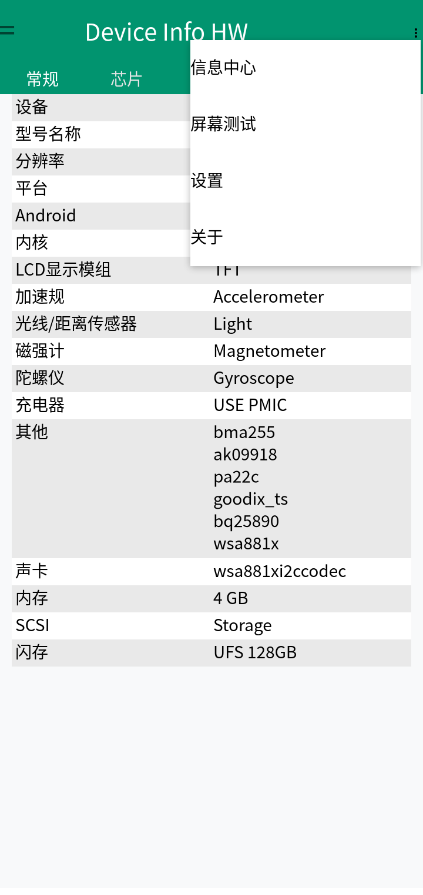
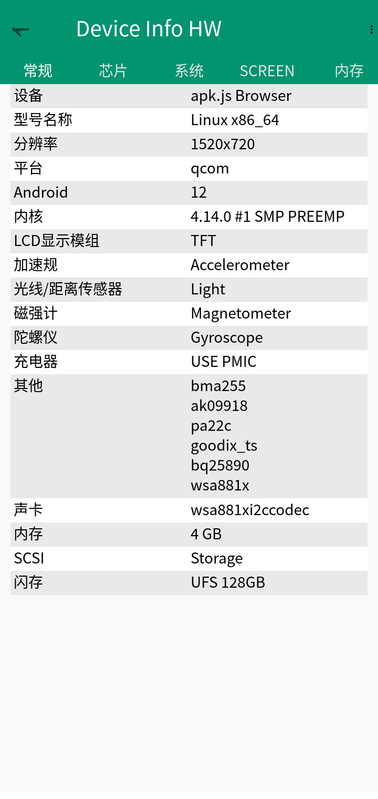

# apk.js

[English](./README.md) | **简体中文**

[文档站](https://caofangkuai.github.io/apk.js/) · [Playground](https://caofangkuai.github.io/apk.js/playground.html)

[](https://github.com/caofangkuai/apk.js/actions/workflows/deploy.yml)
[](https://github.com/caofangkuai/apk.js/stargazers)
[](https://github.com/caofangkuai/apk.js/network/members)
[](https://github.com/caofangkuai/apk.js)
[](https://github.com/caofangkuai/apk.js/blob/main/LICENSE)

在浏览器里运行 Android APK 的纯 JavaScript 模拟器。apk.js 直接解析 APK 里的 `classes.dex`、`AndroidManifest.xml` 和 `resources.arsc`，用 DEX 字节码解释器执行应用逻辑，再用一套 Canvas 版 Android Framework 把界面画出来。整个过程不依赖设备、模拟器或原生库。

> **一切开始，尽在 apk.js**

<p align="center">
  
  
</p>

<p align="center"><em>DeviceInfoHW 在 apk.js 中运行——溢出菜单与抽屉导航。</em></p>

## 特性

- **纯前端。** 解压、解析、执行、渲染都在浏览器内完成，没有后端服务。
- **DEX 解释器。** 覆盖 Dalvik 指令集的主要部分，支持异常处理、`switch`、数组、字段和方法调用。
- **资源解析。** 读取二进制 `AndroidManifest.xml`（AXML）和 `resources.arsc` 资源表。
- **Framework 子集。** `Activity` 生命周期、`View` 树的测量与布局、`LinearLayout` / `FrameLayout` / `RelativeLayout` / `ScrollView`、`TextView` / `Button` / `EditText` / `ImageView` / `ProgressBar` / `ListView` / `Spinner` / `CheckBox` / `RadioGroup` / `SeekBar` / `Dialog`、`ActionBar` / `Toolbar`、`Toast`、`Context` / `Intent` / `Bundle` 等。
- **可绘制资源与主题。** 绘制 `shape` / `vector` / `ripple` / `selector`，解包 `RippleDrawable` 内容，处理 `GradientDrawable`、`backgroundTint`、`@android:color/*` 解析，以及 `Context.setTheme` 的主题继承链。
- **软键盘输入。** 点击 `EditText` 会聚焦并弹出系统键盘（通过隐藏输入框桥接），支持 `InputMethodManager`、光标闪烁，以及 `getSelectionStart` / `setSelection`。
- **系统与反射。** `android.os.Build` / `VERSION`、`Class.forName` / `getMethod` / `Method.invoke`（含基本类型参数拆箱），以及带 `Intent` 参数的 `startActivity` 多 Activity 跳转。
- **可运行示例。** 仓库自带 `samples/hello-dex.apk`，打开页面即可运行，涵盖计数、输入回显、动态添加视图、进度条、形状背景按钮、Build 信息、反射调用，以及跳到第二个 Activity。

## 快速开始

```bash
# 安装依赖
npm install

# 打包到 dist/
npm run build

# 启动本地静态服务器
npm run serve
```

浏览器打开 <http://localhost:8080>，点击「选择 APK」或把 APK 拖进页面。

打包产物 `dist/apk.min.js` 和 `dist/android-framework.min.js` 已经提交在仓库里。把 `index.html`、`dist/`、`vendor/`、`samples/` 放进任意静态服务器就能用，不必先打包。

## 产物说明

`npm run build` 由 webpack 生成两个 ES Module：

| 产物 | 内容 |
| --- | --- |
| `dist/android-framework.min.js` | 纯框架实现：DEX 解析、运行时、资源解析、Canvas 版 Android Framework。不含任何页面或 DOM 逻辑。 |
| `dist/apk.min.js` | 调用层：设备信息、渲染目标、文件加载、状态与日志回调。依赖上一个文件。 |

`index.html` 通过 `<script type="module">` 引用 `dist/apk.min.js`，它会自动加载 `android-framework.min.js`。JSZip 以全局变量形式由 `vendor/jszip.min.js` 提供。

## 在页面中使用

`apk.min.js` 对外暴露 `createSimulator` 和 `ApkSimulator`，由调用方指定设备信息和渲染目标：

```html
<script src="vendor/jszip.min.js"></script>
<script type="module">
  import { createSimulator } from './dist/apk.min.js';

  const sim = createSimulator({
    // 渲染目标：CSS 选择器、DOM 元素，或已有的 canvas
    element: '#phone-screen',
    // 设备信息
    device: {
      width: 360,
      height: 640,
      dpr: window.devicePixelRatio || 1,
      style: 'material',
      maxApkSize: Infinity,
    },
    onLog: (entry) => console.log(`[${entry.level}] ${entry.tag}: ${entry.message}`),
    onFinished: () => console.log('Activity 已结束'),
    onError: (error) => console.error(error),
  });

  // 从 File 对象加载，例如 <input type="file">
  await sim.loadFromFile(file);

  // 也支持 URL、ArrayBuffer 或已解压的 JSZip 实例
  // await sim.loadFromUrl('samples/hello-dex.apk');
  // await sim.loadFromArrayBuffer(buffer);
  // await sim.loadFromZip(zip);

  sim.setDevice({ width: 280, height: 480 }); // 运行中调整尺寸
  sim.destroy();                              // 停止并从目标元素移除 canvas
</script>
```

| 选项 | 说明 |
| --- | --- |
| `element` | 渲染目标。接受 CSS 选择器字符串或 DOM 元素，自动在其中创建 canvas。 |
| `canvas` | 直接使用已有的 `<canvas>`，优先于 `element`。 |
| `device.width` / `device.height` | 逻辑分辨率，默认 360×640。 |
| `device.dpr` | 设备像素比，默认取 `window.devicePixelRatio` 且上限为 2。canvas 物理尺寸为逻辑尺寸乘 dpr。 |
| `device.style` | 主题风格，默认 `default`。 |
| `device.maxApkSize` | APK 大小上限，默认不限制。 |
| `onLog` / `onFinished` / `onError` | 日志、结束、错误回调。 |

| 方法 | 说明 |
| --- | --- |
| `loadFromFile(file)` | 从浏览器 `File` 对象加载。 |
| `loadFromUrl(url, options)` | 用 `fetch` 下载后加载。 |
| `loadFromArrayBuffer(buffer)` | 从二进制内容加载。 |
| `loadFromZip(zip)` | 从 JSZip 实例加载。 |
| `setDevice(device)` | 更新设备信息并立即应用新尺寸。 |
| `capture(type, quality)` | 导出当前画面为 dataURL（默认 PNG）。 |
| `stop()` / `destroy()` | 停止运行 / 停止并清理 canvas。 |
| `vm` | 当前 `JavaVM` 实例（只读）。 |

`sim.on(event, handler)` 返回取消函数，另有 `sim.once`、`sim.off` 和原始 `sim.hooks`（`HookBus`）。

```js
import { createSimulator, hookResult } from './dist/apk.min.js';
const sim = createSimulator({ element: '#screen' });

const off = sim.on('invoke:before', (ctx) => {
  if (ctx.ref.name === 'getDeviceModel') return hookResult('Hooked Device');
});
sim.on('log', (entry) => console.log(entry.level, entry.message));
off();
```

事件：

| 事件 | payload |
| --- | --- |
| `load:before` / `load:after` | `{ simulator, zip, apk?, result? }` |
| `start:before` / `start:after` | `{ engine, apk, vm? }` |
| `invoke:before` | `{ ref, receiver, args, mode, currentMethod, native }`；返回 `hookResult(value)` 可短路调用 |
| `invoke:after` | 同上并带 `result`；返回 `hookResult(value)` 可替换返回值 |
| `log` | `{ level, tag, message, time }` |
| `activity:finish` | `{ engine, vm, activity }` |

开发时用 `npm run build:dev` 生成带 source map 的未压缩版本。

## 目录结构

```
.
├── apk.js                    # 公开入口源码（webpack 入口）
├── index.html                # 演示页面
├── webpack.config.js         # 打包配置
├── dist/                     # 打包产物（已提交）
│   ├── apk.min.js
│   └── android-framework.min.js
├── samples/
│   ├── hello-dex.apk         # 可运行示例 APK
│   └── apk-src/              # 示例 APK 源码
├── src/
│   ├── core/binary.js        # 二进制读取工具
│   ├── dex/                  # DEX 解析与指令定义
│   ├── res/                  # AXML / ARSC 解析
│   ├── runtime/              # VM、解释器、类注册表、值模型
│   └── framework/            # Canvas 版 Android Framework 子集
├── tests/                    # 回归测试
│   └── debug/                # 开发期调试脚本，留作参考
├── image-debug/              # 真实 APK 的 node-canvas 出图
├── tools/                    # 示例 APK 构建脚本与渲染工具
├── docs/                     # VitePress 文档站
└── vendor/jszip.min.js       # JSZip（全局提供）
```

### `src` 各模块职责

| 目录 | 职责 |
| --- | --- |
| `core/` | 字节序安全的二进制读取。 |
| `dex/` | DEX 头、字符串池、类型、方法、字段、类定义与字节码解析。 |
| `res/` | `AndroidManifest.xml` 和 `resources.arsc` 的二进制格式解析。 |
| `runtime/` | `JavaVM`、`DexInterpreter`、`ClassRegistry`，以及 `JavaObject` / `JavaArray` 值模型。 |
| `framework/` | `Engine` 编排、`View` 体系、布局、控件、资源、窗口、`Context` / `Intent`，以及 Java 核心类的 native 实现。 |

## 把真实 APK 渲染成图片

`tools/render-apk.mjs` 用 node-canvas 跑一遍 APK，把 PNG 写进 `image-debug/`：

```bash
npm run render -- /path/to/app.apk my-app
# 输出 image-debug/my-app.png
```

改 `RENDER_WIDTH`、`RENDER_HEIGHT` 或 `RENDER_DENSITY` 可以调整输出尺寸。

## 支持范围与限制

- 只支持**纯 Java/Kotlin APK**。含 `lib/` 原生库的 APK 无法运行。
- APK 大小默认不限制。
- Framework 只覆盖 Android 的一小部分，还在持续扩充。未实现的类或方法会以日志形式报错。
- `startActivity` 只能解析应用内部的 Activity，启动其他应用会抛 `ActivityNotFoundException`。
- 演示页面按 360×640 渲染。

## 测试

```bash
# 完整回归：加载示例 APK 并模拟点击
npm test

# 校验 APK 解析结果
npm run check

# 一次跑完上面两项
npm run diagnose -- /path/to/app.apk
npm run test:ui
npm run test:all
```

`npm test` 会解析 `samples/hello-dex.apk`、构建 View 树，然后依次模拟：点击计数按钮、聚焦编辑框并用键盘输入回显、动态添加视图、推进进度条、点击形状背景按钮、读取 `Build` 信息、跑一次反射调用、`startActivity` 跳到第二个 Activity 并校验传参，最后检查各项事件回调是否生效。

`tests/debug/` 里的脚本是开发期留下的探索性探针，不属于回归测试。


## 构建示例 APK

`tools/build-sample-apk.sh` 演示怎么把 `samples/apk-src` 编译打包成可运行的 APK，需要本机安装 Android SDK 和 build-tools。

## 已知问题

- 部分大型第三方应用在生命周期 `onStart` 阶段仍会失败，原因是 Framework 覆盖不全。
- 调试开关（`DBG_INV`、`DBG_CAST`、`CAS_DBG`、`FV_DBG`）在打包时会被编译期替换成 `false`。
- `tests/debug/` 下约有 400 个开发期临时脚本，留作参考，后续会逐步清理。

## 文档站

VitePress 站点在 `docs/`：

```bash
npm run docs:dev      # 本地开发服务器
npm run docs:build    # 静态构建
npm run docs:preview  # 预览构建产物
```

## 许可

[MIT](./LICENSE)
